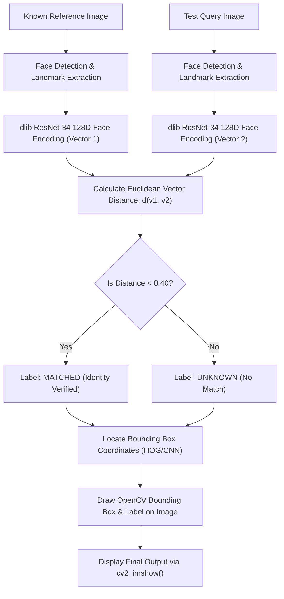

<h1 align="center">Face-recognitionCV</h1>

<p align="center">
  <a href="https://colab.research.google.com/github/dipzz0/Face-recognitionCV/blob/main/Face-recognition.py" target="_blank"></a>
  
  
  
  
</p>

---

## ⚡ Overview

**Face-recognitionCV** is a high-precision computer vision pipeline built with Python and deep metric learning to identify and authenticate individuals between reference and query images.

Powered by `face_recognition` (built on top of `dlib`'s SOTA deep learning ResNet-34 model), this pipeline maps human facial landmarks into a **128-dimensional embedding space**. By computing the **Euclidean vector distance** between face encodings, the system reliably determines whether two faces belong to the same person with high tolerance for changes in lighting, facial expressions, and poses.

---

## 🚀 Key Features

- **🔬 128D Facial Metric Learning:** Extracts invariant 128-dimensional numerical vectors capturing structural facial relationships (eye separation, nose bridge, jawline curve).
- **🎯 Configurable Distance Thresholding:** Applies a strict Euclidean distance threshold (`distance < 0.40`) to balance false acceptance rates (FAR) and false rejection rates (FRR).
- **📦 Dual-Image Interactive Pipeline:** Seamlessly uploads both a Known Reference Image and a Test Query Image directly inside Google Colab using `google.colab.files`.
- **🖼️ Automated Annotation:** Automatically detects facial bounding boxes `(top, right, bottom, left)` and draws labeled green identification boxes on the test image.
- **☁️ Zero-Setup Colab Execution:** Fully pre-configured for instant execution in Google Colab with `opencv-python-headless` and `cv2_imshow`.

---

## 🎮 Workflow & Pipeline Architecture

The flowchart below demonstrates the full biometric verification pipeline:



---

## 📐 Mathematical Intuition

For a reference face encoding $\mathbf{u} \in \mathbb{R}^{128}$ and a test face encoding $\mathbf{v} \in \mathbb{R}^{128}$, the Euclidean distance $D(\mathbf{u}, \mathbf{v})$ is calculated as:

$$D(\mathbf{u}, \mathbf{v}) = \|\mathbf{u} - \mathbf{v}\|_2 = \sqrt{\sum_{i=1}^{128} (u_i - v_i)^2}$$

- **$D(\mathbf{u}, \mathbf{v}) < 0.40$:** Strong confidence match ($\rightarrow$ **Matched**)
- **$D(\mathbf{u}, \mathbf{v}) \ge 0.40$:** Different identities ($\rightarrow$ **Unknown**)

---

## 💻 How to Run in Google Colab

1. **Launch in Colab:**  
   Click the **"Open In Colab"** badge above or open the script directly in [Google Colab](https://colab.research.google.com).

2. **Execute the Code:**  
   Run the notebook cell to install the necessary packages (`face_recognition`, `opencv-python-headless`).

3. **Upload the Images:**  
   - First prompt: Upload your **Known Reference Image** (e.g., a clear profile picture of the target person).
   - Second prompt: Upload your **Test Query Image** (image containing the face you want to verify).

4. **View Results:**  
   The script computes the Euclidean distance, prints the numerical score to console, and renders the test image with annotated bounding boxes.

---

## 🌐 Running Locally

To run the project on your local machine:

1. **Clone the repository:**
   ```bash
   git clone https://github.com/dipzz0/Face-recognitionCV.git
   cd Face-recognitionCV
   ```

2. **Install dependencies:**
   ```bash
   pip install face_recognition opencv-python numpy
   ```

3. **Run the script:**
   ```bash
   python Face-recognition.py
   ```
   *(Note: Replace `cv2_imshow` with standard `cv2.imshow()` and `cv2.waitKey(0)` when running locally outside Colab).*

---

## 🛠️ Technology Stack

| Component | Library / Framework | Purpose |
| :--- | :--- | :--- |
| **Facial Recognition** | [`face_recognition`](https://github.com/ageitgey/face_recognition) | 128D Face Encodings & Landmarks |
| **Deep Learning Backend**| [`dlib`](http://dlib.net/) | Pre-trained ResNet Face Embeddings |
| **Image Processing** | `OpenCV (cv2)` | Image decoding, bounding box & text annotation |
| **Environment** | Google Colab | Cloud GPU/CPU runtime execution |

---

## 📄 License

This repository is distributed under the [MIT License](LICENSE).

---

<p align="center">
  <b>Developed with ❤️ by <a href="https://github.com/dipzz0">dipzz0</a></b>
</p>
